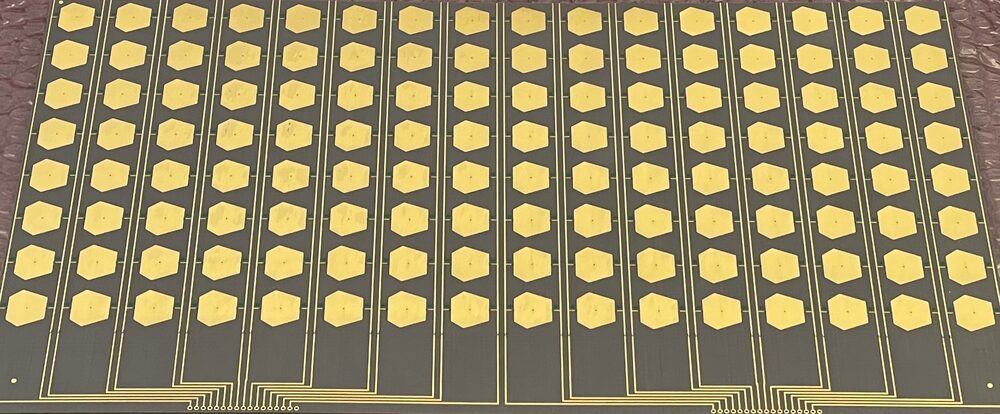
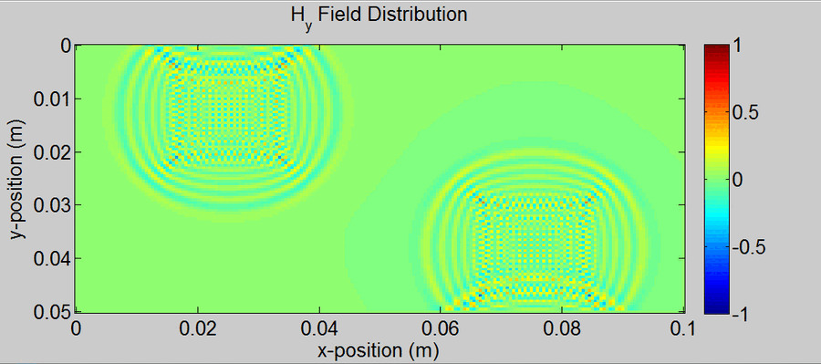
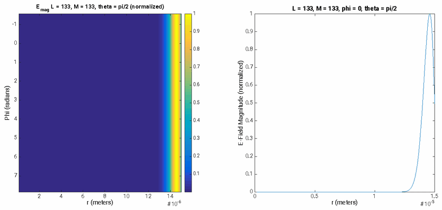
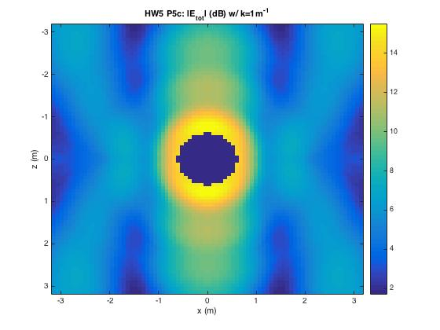
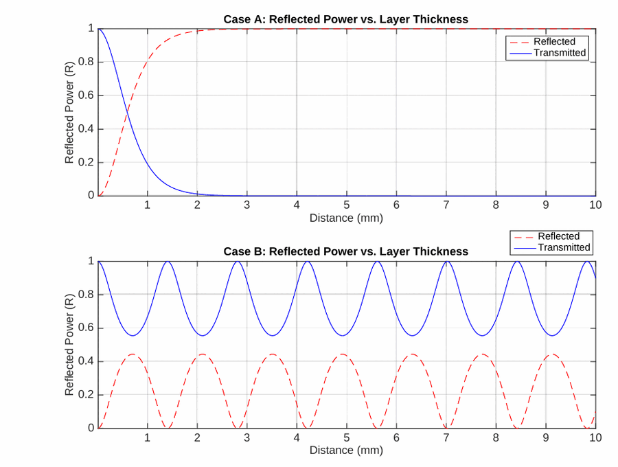
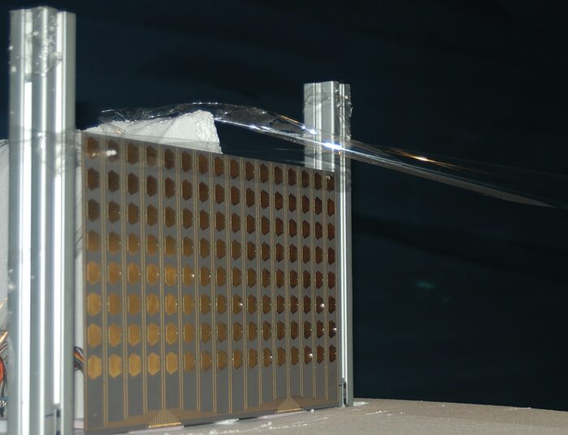
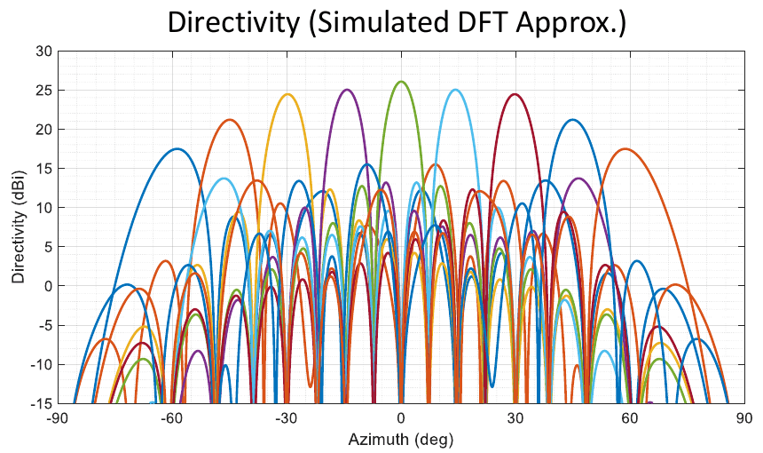

# Electromagnetics Work Samples

Work samples in electromagnetics, RF/antenna engineering and radar systems: graduate research and coursework from Virginia Tech, and public industry talks given at Northrop Grumman. Proprietary work from past employers can't be shared; everything here is academic or approved for public release.

Elsewhere: [john-hodge.com](https://john-hodge.com/) (personal site) · [Research and publications](https://john-hodge.com/research/) · [Google Scholar](https://scholar.google.com/citations?user=SZPSZm0AAAAJ&hl=en) · [LinkedIn](https://www.linkedin.com/in/jhodge007/) · [Phased-array radiation patterns in Python](https://github.com/jman4162/Phased-Array-Antenna-Model)

## Highlights

| | |
|:---:|---|
|  | **PhD dissertation: Reconfigurable Intelligent Metasurfaces for Wireless Communication and Sensing** (2021)<br>A programmable 2-bit metasurface aperture for beam steering, spatial modulation and index modulation in next-generation wireless systems, from design and simulation through fabrication and measurement. Pictured: the fabricated prototype board.<br>[Research write-up](https://john-hodge.com/blog/reconfigurable-intelligent-metasurfaces-phd-research/) · [Dissertation](https://vtechworks.lib.vt.edu/items/9011f677-0fcd-4f1a-9249-f5abe05bb806) · [Defense slides](Hodge-John-PhD-Dissertation-Defense-Nov2021-Final-2.pdf) |
|  | **FDTD simulation of a cavity and a rectangular waveguide** (2016)<br>A from-scratch 1-D and 2-D Yee-scheme solver. It finds resonant modes by FFT; the report compares the waveguide's numerical dispersion relation with the analytical one.<br>[Code + overview](projects/fdtd-waveguide/) · [Report](Hodge_John_ECE_5106_FDTD_Project_Doc_Draft_C.pdf) |
|  | **Whispering gallery modes in a dielectric microsphere** (2016)<br>A spherical-harmonic field expansion and a characteristic-equation search for a high-order (L = 133) resonant mode of a 15 µm-radius sphere.<br>[Code + overview](projects/whispering-gallery-modes/) · [Report](Whispering%20Gallery%20Mode%20-%20Hodge_John_ECE_5106_Final_Exam_Doc_Draft_E.pdf) |
|  | **Scattering from a sphere by multipole expansion** (2016)<br>A plane wave expanded in vector spherical harmonics, the multipole coefficients for a conducting sphere, its scattering cross-section, and a map of the total field.<br>[Code + overview](projects/multipole-scattering/) |
|  | **EM boundaries: multilayer reflection and a slab waveguide** (2015)<br>Transfer-matrix analysis of a three-layer dielectric stack, showing frustrated total internal reflection and thin-film resonances, plus the guided TM mode of a dielectric slab.<br>[Code + overview](projects/dielectric-slab-boundaries/) · [Report](EM%20Boundaries%20-%20Hodge_John_ECE_5105_Final_Exam_Draft_A%20%281%29.pdf) |

## Industry talks: phased-array antenna engineering at Northrop Grumman

- *Multidisciplinary System Design Optimization Using Model-Based Engineering to Support Phased Array Antenna Architectural Trades*, Phoenix Integration International Users' Conference, 2018. [Slides](Phx2018UC_MDAO_Northrop-Grumman_Hodge.pdf)
- *A Model-Based Systems Engineering (MBSE) Approach to the Design & Optimization of Phased Array Antenna Systems*, Phoenix Integration webinar, 2020. [Slides](A%20Model-Based%20Systems%20Engineering%20%28MBSE%29%20Approach%20to%20the%20Design%20%26%20Optimization%20of%20Phased%20Array%20Antenna%20Systems-MC_Presentation-2020-Final-1.pdf) · [Webinar page](https://www.phoenix-int.com/a-model-based-systems-engineering-mbse-approach-to-the-design-optimization-of-phased-array-antenna-systems-webinar-northrop-grumman-mission-systems/)
- Featured in an Ansys customer case study: [ModelCenter + Northrop Grumman](https://www.ansys.com/content/dam/resource-center/case-study/modelcenter-northrop-grumman-case-study.pdf)

## Research

**PhD dissertation: Reconfigurable Intelligent Metasurfaces for Wireless Communication and Sensing Applications** (Virginia Tech, 2021). [Research write-up](https://john-hodge.com/blog/reconfigurable-intelligent-metasurfaces-phd-research/) · [Dissertation](https://vtechworks.lib.vt.edu/items/9011f677-0fcd-4f1a-9249-f5abe05bb806) · [Defense slides](Hodge-John-PhD-Dissertation-Defense-Nov2021-Final-2.pdf)

| Fabricated prototype | Under test in the ARL tapered range | Simulated beam steering |
|:---:|:---:|:---:|
|  |  |  |
| PIN-diode-controlled hexagonal meta-atoms; each column is driven by two digital control lines | Radiation patterns measured in center-fed and offset-fed configurations | 2-bit phase states steer the beam across ±60° in azimuth |

- Full publication list: [john-hodge.com/research](https://john-hodge.com/research/)
- Master's thesis: *Analysis of Periodic and Random Capacitively-Loaded Loop (CLL) Metamaterial Structures for Antenna Enhancement Applications*. [Thesis](https://vtechworks.lib.vt.edu/items/d62c3c0f-6957-4543-800e-e33d28bef215)

## Coursework and exams (Virginia Tech)

| Year | Topic | Course | Materials |
|------|-------|--------|-----------|
| 2016 | EM Waves PhD qualifying exam (problems listed below) | Qualifying exam | [Presentation](VT%20EM%20Waves%20Qualifying%20Exam%20Presentation_C.pdf) · [Written answers](Hodge_John_Qualifying_Exam_Answers_E1.pdf) |
| 2016 | Whispering gallery modes in a spherical dielectric resonator | ECE 5106 final exam | [Report](Whispering%20Gallery%20Mode%20-%20Hodge_John_ECE_5106_Final_Exam_Doc_Draft_E.pdf) · [Code](projects/whispering-gallery-modes/) |
| 2016 | FDTD waveguide simulation | ECE 5106 project | [Report](Hodge_John_ECE_5106_FDTD_Project_Doc_Draft_C.pdf) · [Code](projects/fdtd-waveguide/) |
| 2016 | EM scattering by multipole expansion of spherical harmonics | ECE 5106 homework | [Code + plots](projects/multipole-scattering/) |
| 2015 | EM boundaries: TE/TM waves through a multilayer dielectric slab | ECE 5105 final exam | [Report](EM%20Boundaries%20-%20Hodge_John_ECE_5105_Final_Exam_Draft_A%20%281%29.pdf) · [Code](projects/dielectric-slab-boundaries/) |
| 2014 | Radar signal processing: clutter suppression for a ground-based L-band ARSR-3 air traffic control radar | ECE 5636 final exam | [Report](Hodge_John_ECE_5636_Final_Exam_Report%20-%20Analysis%20of%20Various%20Clutter%20Suppression%20Methods%20for%20a%20Ground-Based%20L-Band%20ARSR-3%20Air%20Traffic%20Control%20Radar%20System.pdf) |
| 2013 | Radar systems design: C-band airport surveillance radar | ECE 5635 design project | [Report](Hodge_John_ECE%205635%20Radar%20Systems_REVISED.pdf) |

The qualifying exam had five problems:
1. A submarine communicating with an overhead surveillance aircraft
2. Detection trades and analysis of an F-XY fighter aircraft against enemy radar
3. Transmission-line single-stub impedance matching
4. Radar cross-section (RCS) of a spinning dumbbell target made of two small PEC spheres
5. Fields and power radiated by a rotating bar magnet

## Related open-source tools

| Repository | What it is |
|---|---|
| [RF-and-Antenna-Tutorials](https://github.com/jman4162/RF-and-Antenna-Tutorials) | Worked-problem Python notebooks, including modern, tested versions of the FDTD, multilayer and sphere-scattering projects in this repo |
| [OpenEM Wave Lab](https://github.com/jman4162/openem-wave-lab) | Interactive browser lessons on electromagnetic wave physics ([live demo](https://jman4162.github.io/openem-wave-lab/)) |
| [metasurface-py](https://github.com/jman4162/metasurface-py) | Programmable metasurface (RIS) design, beamforming under hardware constraints, and channel and sensing models; builds on the PhD research above |
| [Phased-Array-Antenna-Model](https://github.com/jman4162/Phased-Array-Antenna-Model) | Array-factor computation, beamforming and 3-D radiation-pattern visualization |
| [phased-array-systems](https://github.com/jman4162/phased-array-systems) | System-level phased-array design, optimization and trade studies for communications and radar |
| [EdgeFEM](https://github.com/jman4162/EdgeFEM) | 3-D finite-element frequency-domain solver for waveguides, patch antennas and periodic unit cells |
| [antenna-cad](https://github.com/jman4162/antenna-cad) | Compiles antenna and phased-array design intent into simulation-ready KiCad PCB layouts |
| [opensatcom](https://github.com/jman4162/opensatcom) | Satellite link margin and capacity from antenna, RF chain, propagation and mission time series |

## Repository layout

```
projects/   MATLAB code, one folder per project, each with its own README
assets/     Figures used in the READMEs
*.pdf       Reports and slides (kept at the top level so existing links keep working)
```

The code is the original MATLAB from 2015–2016. Each project's README explains what the scripts compute and how to run them.

## License

- Code (`.m` and `.mat` files): MIT. See [LICENSE](LICENSE).
- Reports, slides and figures: © John Hodge, all rights reserved. See [LICENSE-docs.md](LICENSE-docs.md).
- Northrop Grumman presentations: © Northrop Grumman, approved for public release. Covered by neither license above.
