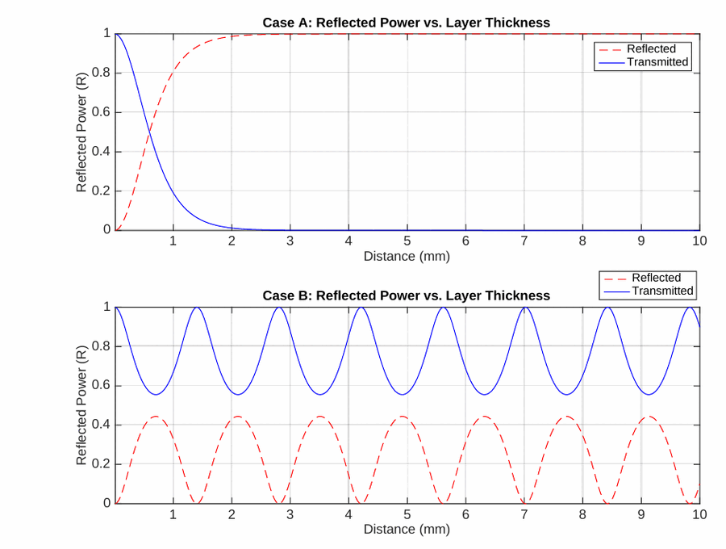

# EM Boundaries: Multilayer Dielectric Reflection and a Slab Waveguide

*Virginia Tech ECE 5105 final exam, December 2015. Written in MATLAB.*

Transfer-matrix analysis of plane waves crossing a three-layer dielectric stack, plus the guided TM mode of a dielectric slab waveguide.

*Reflected and transmitted power vs. middle-layer thickness. In Case A the middle layer is optically thinner, so the wave tunnels through and transmission decays as the layer gets thicker (frustrated total internal reflection). In Case B it is denser, giving periodic Fabry–Pérot-style resonances. Figure from the exam report.*

## What it does

**Problem 1: TE plane wave through a three-layer stack** (`Hodge_John_ECE_5105_Final_Exam_P1.m`)
- TE-polarized wave incident at 60° with ω = 3 × 1011 rad/s (λ ≈ 6.3 mm); outer layers ε1 = ε3 = 4ε0.
- Sweeps the middle-layer thickness from 0.01 to 10 mm for two cases: ε2 = ε0 (Case A) and ε2 = 8ε0 (Case B).
- Computes the reflected and transmitted power fractions from the boundary-condition transfer matrices.

**Problem 2: TM dielectric slab waveguide** (`..._P2a.m`, `..._P2b.m`)
- 0.5 µm-thick core at λ = 1 µm.
- **2a:** finds the propagation constant β of the fundamental TM mode graphically, from the zero of the transfer-matrix element (TTM)11.
- **2b:** plots the Hy field profile and the z-component of the time-averaged Poynting vector across both cladding layers and the core.

## Files

| File | Purpose |
|------|---------|
| `Hodge_John_ECE_5105_Final_Exam_P1.m` | Reflection and transmission vs. layer thickness, Cases A and B |
| `Hodge_John_ECE_5105_Final_Exam_P2a.m` | Graphical solution for the fundamental TM mode's β |
| `Hodge_John_ECE_5105_Final_Exam_P2b.m` | Field profile and Poynting vector of the guided mode |

## Running

Each script is standalone. Open MATLAB in this folder and run it by name, e.g. `Hodge_John_ECE_5105_Final_Exam_P1`. Each script starts with `clear all; close all`, so save your workspace first.

## Report

[Full exam report (PDF, 24 pages)](../../EM%20Boundaries%20-%20Hodge_John_ECE_5105_Final_Exam_Draft_A%20%281%29.pdf): derivations, k-vector tables, a total-internal-reflection analysis and the results.
