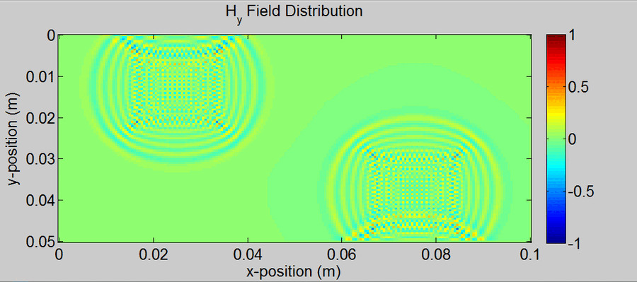

# FDTD Simulation of a 1-D Cavity and a 2-D Rectangular Waveguide

*Virginia Tech ECE 5106 (EM Fields II) course project, spring 2016. Written in MATLAB.*

A from-scratch finite-difference time-domain (FDTD) solver using the Yee scheme. It finds the resonant modes of a 1-D cavity and the dispersion relation of a PEC rectangular waveguide, then checks both against the analytical solutions.

*Hy field snapshot from the 2-D simulation (figure from the project report).*

## What it does

**1-D cavity:** `FDTD_1D_Take2_C.m`
- PEC-bounded cavity, L = 30, N = 31 nodes, normalized units (ε = μ = 1), Δt = 0.5 Δz, 10,000 time steps.
- Takes the FFT of Ex and Hy to find the resonant frequencies, then compares them with the analytical modes fm = m / 2L.
- Starts from single-mode, multi-mode and random initial fields, and uses a spatial FFT filter to isolate individual modes.

**2-D waveguide cross-section:** `ECE_5106_FDTD_Project_2D_A6.m`
- 0.1 m × 0.05 m PEC rectangular waveguide on a 51 × 51 grid, with Δt set to 0.4 × the Courant stability limit.
- Gaussian-pulse excitation, with the propagation constant β included in the update equations.
- Finds the TE/TM mode frequencies by FFT and compares the numerical β–f dispersion curve with the analytical one. The report shows close agreement.
- Varies Δt, Δx and the number of time steps to show how each trades accuracy against run time.

## Files

| File | Purpose |
|------|---------|
| `FDTD_1D_Take2_C.m` | 1-D cavity FDTD simulation and modal FFT analysis |
| `ECE_5106_FDTD_Project_2D_A6.m` | 2-D waveguide FDTD simulation and dispersion analysis |

## Running

Both scripts are standalone. Open MATLAB in this folder and run either one by name, e.g. `FDTD_1D_Take2_C`. Each script starts with `clear all; close all`, so save your workspace first. Neither has been tested in GNU Octave.

## Report

[Full project report (PDF, 55 pages)](../../Hodge_John_ECE_5106_FDTD_Project_Doc_Draft_C.pdf): derivations, update equations, boundary conditions, results and the parameter studies.
