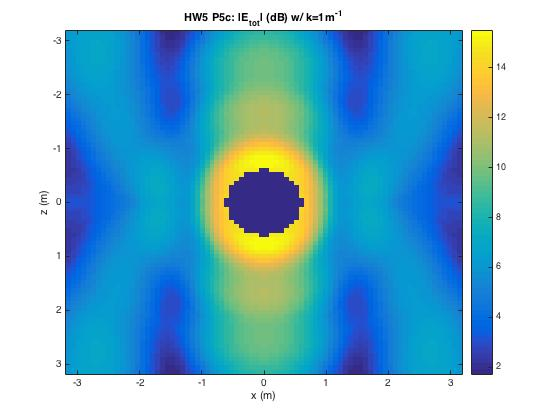

# EM Scattering from a Sphere Using a Multipole (Vector Spherical Harmonic) Expansion

*Virginia Tech ECE 5106 (EM Fields II) homework set 5, spring 2016. Written in MATLAB.*

Expands an incident plane wave in vector spherical harmonics, solves for the multipole scattering coefficients of a perfectly conducting sphere, and maps the total field around it.

*Total electric field magnitude |Etot| (dB) around a sphere of radius a = 0.6 m with k = 1 m−1 (ka = 0.6). The field is set to zero inside the sphere.*

## What it does

- **Problem 4: plane-wave expansion.** Writes the incident plane wave as a sum over L of spherical Bessel functions jL(kr) times vector spherical harmonics **X**LM. It checks convergence by rebuilding Re[**e**x · **E**inc] over a grid as more L terms are added.
- **Problem 5a: scattering coefficients.** Applies the conducting-sphere boundary conditions at r = a to get the multipole coefficients αL = −2 jL(ka) / hL(1)(ka) and βL = −2 [x jL(x)]′ / [x hL(1)(x)]′, evaluated at x = ka.
- **Problem 5b: scattering cross-section.** σs = π/(2k²) Σ (2L+1)(|αL|² + |βL|²), with a plot of each L-term's contribution.
- **Problem 5c: total field map.** Sums the incident and scattered multipole series to map |Etot| on a grid around the sphere (figure above).

Radial derivatives of the Bessel and Hankel functions, and angular derivatives of YLM, are computed with central finite differences (step h = 10−5 in most scripts).

## Files

| File | Purpose |
|------|---------|
| `ECE_5106_HW5_P4a.m` | Problem 4a, first attempt: computes YLM and ∂YLM/∂θ at one point, then stops (incomplete) |
| `ECE_5106_HW5_P4a_take2.m` | Problem 4a: plane-wave expansion on an x–z grid |
| `ECE_5106_HW5_P4a_take2b.m`, `ECE_5106_HW5_P4b.m` | Problem 4: Re[**e**x · **E**inc] maps on the x–z and x–y planes |
| `ECE_5106_HW5_P5a.m`, `ECE_5106_HW5_P5a_Take2.m` | Problem 5a: αL and βL coefficients (two versions) |
| `ECE_5106_HW5_P5b.m`, `ECE_5106_HW5_P5b_Take2.m` | Problem 5b: scattering cross-section (two versions; `_Take2` loads `L_alpha_beta_coeff_arr.mat`) |
| `ECE_5106_HW5_P5c_Take1.m` | Problem 5c: total field map |
| `L_alpha_beta_coeff_arr.mat` | Saved αL, βL table used by `ECE_5106_HW5_P5b_Take2.m` |
| `ECE_5106_HW5_P4b.fig` | MATLAB figure file for Problem 4b |
| `function_spherical_bessel.m`, `besselj_sph.m` | Spherical Bessel function jL; note the argument orders differ: `function_spherical_bessel(x, L)` vs. `besselj_sph(L, x)` |
| `function_hankel_first.m` | Spherical Hankel function hL(1), called as `(x, L)` |
| `function_calc_f_L_kr.m`, `function_calc_f_L_kr_B.m`, `function_calc_g_L_kr.m` | Radial functions fL(kr) and gL(kr) for the total field |
| `func_calc_Y_LM.m`, `Y_lm_func2.m` | Scalar spherical harmonics YLM |
| `func_calc_dY_LM_dtheta.m`, `func_calc_dY_LM_dphi.m` | Numerical ∂YLM/∂θ and ∂YLM/∂φ |
| `function_XLM_theta.m`, `function_XLM_phi.m` | θ and φ components of **X**LM |
| `plots/` | Output figures for Problems 4b and 5c |

## Running

Open MATLAB in this folder and run a script by name, e.g. `ECE_5106_HW5_P5c_Take1`. Every helper function the scripts call is in this folder. Each script starts with `clear all`, so save your workspace first.

## Report

There is no standalone report for this homework set; the figures in [`plots/`](plots/) are its outputs.
