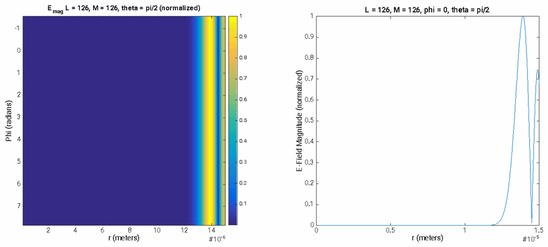

# Whispering Gallery Modes in a Spherical Dielectric Resonator

*Virginia Tech ECE 5106 (EM Fields II) final exam, May 2016. Written in MATLAB.*

Finds the resonant whispering gallery modes (WGMs) of a 15 µm-radius dielectric microsphere in the near-infrared (λ ≈ 0.93–0.98 µm) using a spherical-harmonic field expansion.

*Normalized |E| for an L = M = 126 mode at θ = π/2: the field is concentrated just inside the sphere's surface, which is the defining feature of a whispering gallery mode. Figure from the exam report.*

## What it does

- **Geometry:** a sphere of radius a = 15 µm with core index n = 1.4 and cladding index n = 1.1. The search considers TE modes with L = M.
- **Fields:** spherical Bessel functions jL(kr) inside the sphere, spherical Hankel functions hL(1)(kr) outside, and vector spherical harmonics **X**LM for the angular dependence.
- **Part A:** matching the tangential fields at r = a gives a characteristic equation. The scripts scan ω across the allowed band for each mode order L. The report finds a resonance near L = 133, ω ≈ 2.006 × 1015 rad/s, and confirms it with a second method (the zero of a matrix determinant).
- **Part B:** computes the time-averaged electric and magnetic energy stored in the resonant mode.

## Files

| File | Purpose |
|------|---------|
| `ECE_5106_FDTD_Final_Exam_A_L_search.m` | Part A: scans ω for a given L and plots both sides of the characteristic equation |
| `ECE_5106_FDTD_Final_Exam_Part_A_plot_fields.m` | Part A: plots the mode's field magnitude vs. r and φ |
| `ECE_5106_FDTD_Final_Exam_B_omega_search.m` | Part B: finer frequency search around the resonance |
| `ECE_5106_FDTD_Final_Exam_B.m` | Part B: evaluates the characteristic equation at the chosen resonant frequency |
| `plot_YLM.m` | Plots the components of the vector spherical harmonic **X**LM |
| `plot_sph_besselj.m` | Plots the spherical Bessel function jL(kr) inside the sphere |
| `Y_lm_func.m`, `Y_lm_func2.m`, `func_calc_Y_LM.m` | Scalar spherical harmonics YLM (different normalizations and angle units) |
| `dY_lm_theta_func.m`, `func_calc_dY_LM_dtheta.m` | Numerical ∂YLM/∂θ |
| `function_XLM_theta.m`, `function_XLM_phi.m` (+ `_mod` variants) | θ and φ components of **X**LM |
| `besselj_sph.m`, `function_spherical_bessel.m` | Spherical Bessel function jL |
| `ece_5106_final_exam_plot_trial_B.jpg` | Example output plot |

Despite "FDTD" in their names, these scripts solve the problem analytically; they are not FDTD simulations.

## Running

Open MATLAB in this folder and run a script by name. **Known issue:** the four `ECE_5106_FDTD_Final_Exam_*` scripts call a spherical Hankel function, `function_hankel_first`, that wasn't in the original upload. The version in [`../multipole-scattering`](../multipole-scattering/function_hankel_first.m) takes its arguments as `(x, L)`, but the characteristic-equation lines here call it as `(L, x)`. These scripts need that reconciled before they will run correctly. `plot_YLM.m` and `plot_sph_besselj.m` don't use that function.

## Report

[Full exam report (PDF, 23 pages)](../../Whispering%20Gallery%20Mode%20-%20Hodge_John_ECE_5106_Final_Exam_Doc_Draft_E.pdf): derivation of the characteristic equation, the mode search, field plots and the stored-energy calculation.
